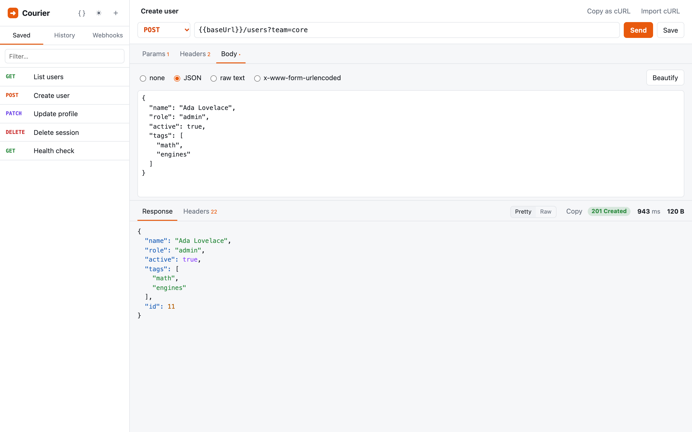
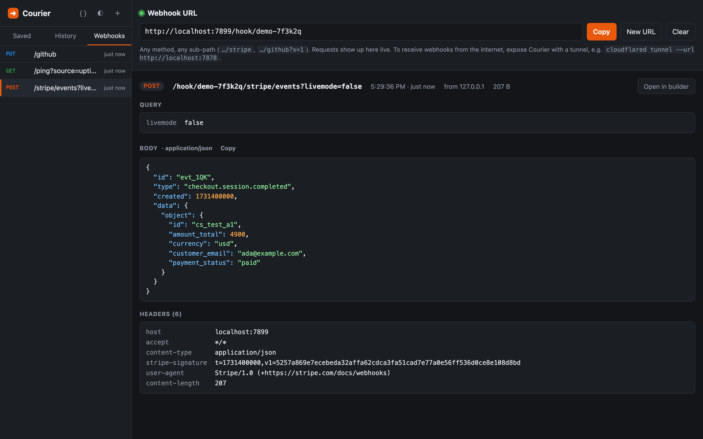

<div align="center">


# Courier

**A tiny, self-hosted Postman alternative with a built-in webhook debugger.**
One Rust binary. No login, no account, no cloud sync, no Electron.

[](LICENSE)
[](https://www.rust-lang.org)


<br>

<picture>
  <source media="(prefers-color-scheme: dark)" srcset="docs/screenshot-dark.png">
  
</picture>

</div>

---

## Why

Most API clients have grown into platforms with logins, workspaces, cloud sync and a 500 MB download.
Sometimes you just want to **fire a request and look at the response**. Courier is that, plus a webhook inbox, in a single file you can run anywhere.

## Features

| | |
|---|---|
| ⚡ **Every method** | `GET` `POST` `PUT` `PATCH` `DELETE` `HEAD` `OPTIONS` |
| 🧩 **Request builder** | Query params synced with the URL, headers, and JSON / raw text / form-urlencoded bodies |
| 🎨 **Readable responses** | Status, time and size at a glance, syntax-highlighted JSON, pretty/raw toggle, one-click copy |
| 📋 **cURL in, cURL out** | Paste a curl command straight into the URL bar to import it; copy any request back out as curl |
| 🔤 **Variables** | Define `{{baseUrl}}` or `{{token}}` once and use them in the URL, headers and body |
| 🪝 **Webhook debugger** | A personal URL that catches any request and shows it live, ready to replay into the builder |
| 💾 **Saved requests & history** | Kept in one plain JSON file you can back up, diff or commit |
| 🌗 **Light & dark** | Follows your OS, or pick one yourself |
| 🚫 **No CORS pain** | Requests are sent by the Courier server, not the browser |
| 📦 **Tiny footprint** | One ~8 MB binary with the UI built in, plain HTML/JS, no build step |

## Quick start

### With Cargo

```sh
git clone https://github.com/NoahBohme/courier.git
cd courier
cargo run --release
```

Open **http://127.0.0.1:7878** and start sending requests.

### With Docker

```sh
docker build -t courier .
docker run -p 127.0.0.1:7878:7878 -v courier-data:/data courier
```

Saved requests, history and variables go in the `courier-data` volume.

## Tour

### 📋 Paste a cURL command

Copy a request from your browser's DevTools (*Copy as cURL*) or from API docs, and paste it into the URL bar. Courier fills in the method, URL, params, headers, auth and body, and picks the right body type and pretty-prints JSON.

```sh
curl -X POST 'https://api.example.com/users?team=core' \
  -H 'Authorization: Bearer abc123' \
  --json '{"name": "Ada Lovelace", "role": "admin"}'
```

It reads `-X`, `-H`, `-d`/`--data*`, `--json`, `--data-urlencode`, `-u` (Basic auth), `--oauth2-bearer`, `-A`, `-e`, `-b`, `-G`, `-I`, combined flags like `-sSL`, quotes, `$'…'` strings and `\` line breaks.
Flags it can't use, like `-F` multipart or `@file` bodies, are skipped and listed in a short note.

**Copy as cURL** goes the other way, with variables filled in.

### 🔤 Variables

Click **`{ }`** in the sidebar to define variables, then use them anywhere:

```
{{baseUrl}}/users/42
Authorization: Bearer {{token}}
```

Switching between staging and production means changing one value.

### 🪝 Webhook debugger



Open the **Webhooks** tab to get a personal URL like `http://localhost:7878/hook/k3j9x2…`.

- Accepts **any method** on **any sub-path**: `…/hook/<id>/stripe`, `…/hook/<id>/github?x=1`
- Requests appear **live** (Server-Sent Events), with an unread badge when you're in another tab
- See the method, path, query, headers, pretty-printed body, source IP, size and time
- **Open in builder** loads a captured webhook into the request builder so you can replay it against your local app

To receive webhooks from Stripe, GitHub and other services on the internet, expose Courier with a tunnel:

```sh
cloudflared tunnel --url http://localhost:7878
# or: ngrok http 7878
```

> Captures live in memory: up to 100 per URL, bodies up to 512 KB each. They're cleared when Courier restarts.

### ⌨️ Keyboard shortcuts

| Shortcut | Action |
|---|---|
| <kbd>⌘/Ctrl</kbd> + <kbd>Enter</kbd> | Send request (press again to cancel) |
| <kbd>⌘/Ctrl</kbd> + <kbd>S</kbd> | Save request |
| <kbd>⌘/Ctrl</kbd> + <kbd>K</kbd> | New request |
| <kbd>Enter</kbd> in the URL bar | Send request |
| <kbd>Esc</kbd> | Close dialogs |

## Configuration

Courier is configured with environment variables:

| Variable | Default | Description |
|---|---|---|
| `COURIER_HOST` | `127.0.0.1` | Address to bind to |
| `COURIER_PORT` | `7878` | Port to listen on |
| `COURIER_DATA` | `courier-data.json` | Where saved requests, history and variables are stored |

```sh
COURIER_PORT=9000 COURIER_DATA=~/.courier.json cargo run --release
```

## How it works

```
 Browser UI ──(JSON)──▶  Courier (Rust · axum)  ──(HTTP)──▶  Your API
                              │
 Stripe / GitHub ─▶ /hook/<id> ┤──(SSE)──▶ Webhooks tab
                              │
                     courier-data.json
```

- The UI is one HTML file built into the binary with `include_str!`. No framework and no bundler.
- `POST /api/send` makes the real request with [`reqwest`](https://github.com/seanmonstar/reqwest) (rustls, HTTP/2, gzip/brotli) and returns status, headers, body and timing.
- `GET`/`PUT /api/state` reads and writes the JSON data file. Writes are atomic: a temp file, then a rename.
- `ANY /hook/{id}/*` captures webhooks. `GET /api/hooks/{id}/stream` streams them to the UI.

<details>
<summary><b>Project layout</b></summary>

```
├── src/main.rs        # server: request proxy, state file, webhook capture + SSE
├── static/index.html  # the entire UI (HTML + CSS + vanilla JS)
├── Dockerfile
└── docs/              # screenshots
```

</details>

## ⚠️ Security

Courier has **no authentication by design**. Anyone who can reach it can:

- make HTTP requests **from your server** (it's an open proxy for them)
- read your saved requests, which may include tokens

That's why it binds to `127.0.0.1` by default. If you run it on a server or set `COURIER_HOST=0.0.0.0`, put it behind a VPN (Tailscale, WireGuard) or a reverse proxy with auth (Caddy `basicauth`, Cloudflare Access, …).

## Contributing

Issues and PRs are welcome. The goal is to stay **small and simple**, so please open an issue before starting a large feature.

```sh
cargo run   # the UI is compiled into the binary, so restart after editing static/index.html
```

## License

[MIT](LICENSE) © 2026 Noah Böhme Rasmussen
